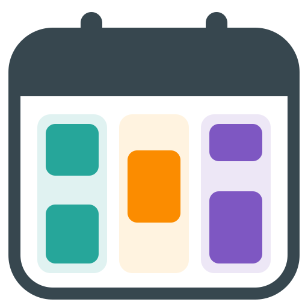

# Household Calendar Splitter



A Home Assistant integration that turns shared calendars into one read-only
calendar per household member, based on the names in each event's title.

`Oscar and Felix - swimming` on a shared Google calendar becomes *swimming* on
`calendar.oscar` and on `calendar.felix`. Events that mention nobody go to a
separate household calendar, so nothing gets lost. Wall displays, dashboards
and automations can then show or act on each person's plans on their own.

- Works with any calendar Home Assistant can read: Google, CalDAV, Local
  Calendar and others.
- People, nicknames and groups ("kids", "everyone") are set up in the UI.
- Source calendars are only read. Nothing is created, changed or deleted in
  them, and nothing is sent anywhere else.
- Deterministic matching: no AI, no cloud and no guessing.

Requires Home Assistant **2026.3** or later (tested on 2026.10).

## Installation

### HACS (recommended)

1. In HACS, open the menu → **Custom repositories**, add
   `https://github.com/duncanjmck/household-calendar-splitter` with category
   **Integration**.
2. Install **Household Calendar Splitter** and restart Home Assistant.

### Manual

Copy `custom_components/family_calendar_splitter` into your Home Assistant
`config/custom_components/` folder and restart.

> The folder and domain are `family_calendar_splitter` for compatibility with
> existing installs. Only the display name differs.

## Setup

1. **Settings → Devices & services → Add integration → Household Calendar
   Splitter.**
2. Choose the source calendars to read, and optionally type the names of the
   people in your household (one per line).

Each person gets a calendar such as `calendar.oscar`. Events that mention
nobody go to `calendar.household_events` (you can rename it).

### Managing the household

Everything is on the integration's page:

- **Add person**: their name is always recognised; add nicknames or
  alternative spellings as *other names*. *Match capitalisation exactly* makes
  "Will" match but not "will". If a name is also an everyday word you'll be
  offered this automatically.
- **Add group**: a word that means several people, such as `kids`. Turn on
  *everyone in the household* for a word like `everyone` that should always
  include every person, including people added later.
- **Edit** (⋮ next to a person or group): renaming a person keeps their
  calendar and its entity ID.
- **Delete** a person to remove their calendar. Groups stop including them.
- **Configure**: source calendars, how names are recognised, the words that
  join names, title clean-up, duplicate removal, and the name of the household
  calendar.

Changes apply immediately, without a restart.

## How titles are matched

Names must be whole words: `Tomorrow` doesn't match Tom, and `Isabella`
doesn't match Isa. Possessives are recognised (`Oscar's party`). Several names
can be joined with *and*, commas, `&`, `+` or `/`.

| Mode | Recognises | Ignores |
| --- | --- | --- |
| Anywhere (default) | `Swim with Oscar`, `Oscar - swim` | — |
| At the start | `Oscar and Felix - swim` | `Swim with Oscar` |
| Only when tagged | `Oscar: swim`, `[Oscar] swim`, `Swim [Oscar, Felix]` | `Oscar swim` |

Use a stricter mode, or exact capitalisation, when household names are also
ordinary words (Rose, Will, May…).

Recognised names are removed from each person's copy of the title, together
with any punctuation or joining word directly attached to them. Everything
else is kept as written:

| Source title | On each person's calendar |
| --- | --- |
| `Oscar and Felix — swimming` | `swimming` (Oscar and Felix) |
| `Felix 3:30 dentist` | `3:30 dentist` |
| `Lunch with Isla` | `Lunch` |
| `Swim - Oscar - 4:15pm` | `Swim - 4:15pm` |
| `Oscar's birthday party` | `birthday party` |
| `Izzy` | `Izzy` (nothing would be left, so the title is kept) |

Turn off *remove names from event titles* to keep titles unchanged. The
joining word (`and`) and the words removed before a name (`with`) can be
changed for other languages, e.g. `und` and `mit`.

Events that mention someone appear only on their calendars, not on the
household calendar.

## Duplicate events

When the same event is on more than one source calendar (typically a Google
invite that appears on both the organiser's and the guest's calendar), each
person's calendar shows it once. Copies count as the same event when their
title, start, end and location match (ignoring capitalisation and spacing).
Shared events are unaffected: `Oscar and Felix - swim` is still one event on
Oscar's calendar and one on Felix's.

Two genuinely separate events with identical details for the same person
would also be shown once. Turn off *Remove duplicate events* under
**Configure** if that matters for your household.

## Previewing a title

The **Preview event title** action shows where a title would go, without
changing anything:

```yaml
action: family_calendar_splitter.preview_title
data:
  title: "Oscar and Felix — swimming 3:30"
```

```yaml
matched: true
people: [Oscar, Felix]
calendars: [calendar.oscar, calendar.felix]
summary: swimming 3:30
mode: anywhere
```

## Behaviour and limits

- Refreshes every 15 minutes, covering 14 days back to 60 days ahead.
  Requests in that window are answered from memory.
- Earlier or later dates (e.g. browsing past months in the calendar panel)
  are fetched from the sources when asked for, and cached for 5 minutes.
- Each source calendar is read separately. If one can't be read, the others
  still update, its last received events stay visible, and a warning is
  logged.
- The derived calendars are read-only. Edit events in the source calendar.
- Supports all-day and timed events, descriptions and locations.

## Development

The parser, model, storage and splitting logic is plain Python with tests
that need no Home Assistant install:

```text
python tests/test_parser.py
python tests/test_splitter.py    # or: pytest tests
```

GitHub Actions runs these together with hassfest and HACS validation.

```text
custom_components/family_calendar_splitter/
  __init__.py       Setup, reload, actions and config entry migrations
  brand/            Integration icon (Home Assistant 2026.3+)
  calendar.py       Read-only derived calendar entities
  config.py         Storage <-> household conversion
  config_flow.py    Setup, settings, and person/group flows
  coordinator.py    Fetching, caching and on-demand ranges
  migration.py      Unique ID migration helpers
  models.py         Household data model and validation
  parser.py         Title classification
  services.py       Preview action
  splitter.py       Splitting events onto calendars, duplicate removal
assets/icon.svg     Icon source
tests/              Tests that run without Home Assistant
```

## Changelog

### 0.6.0

First public release.

- Renamed to Household Calendar Splitter (domain unchanged).
- Integration icon included.
- New installs name the catch-all calendar "Household events".

Earlier private versions developed the features above: UI-managed people and
groups (0.4), resilient per-source fetching, on-demand ranges, duplicate
removal and the preview action (0.5).

## License

MIT
